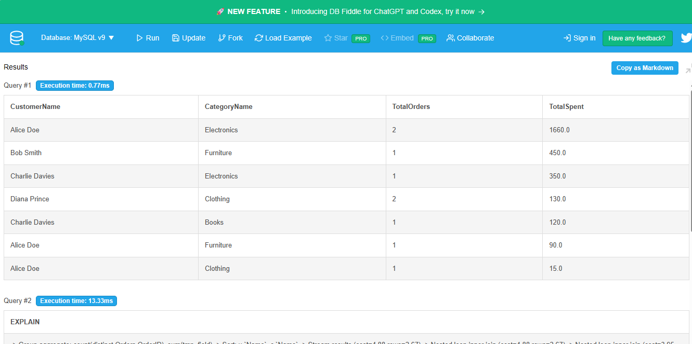
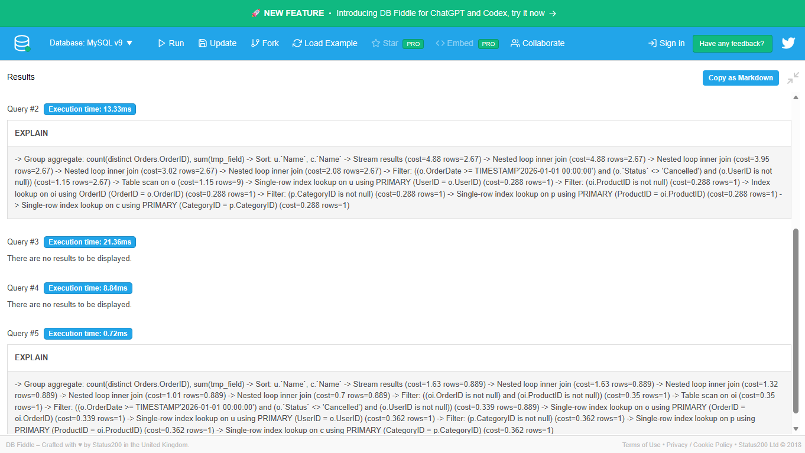

# Portfolio 2: Query Processing and Optimisation

## 1. Business Context & Query Design

For the **Joel Mega Store** e-commerce platform, store managers need analytics on customer purchasing habits across various product categories.

The query aggregates customer spending by category for non-cancelled orders placed from 2026 onward:

- Joins five tables: `Users`, `Orders`, `OrderItems`, `Products`, and `Categories`.
- Filters out invalid transactions using `WHERE o.OrderDate >= '2026-01-01' AND o.Status != 'Cancelled'`.
- Uses aggregate functions `COUNT(DISTINCT o.OrderID)` and `SUM(oi.Quantity * oi.UnitPrice)` grouped by user and category.

## 2. Execution Plan Analysis (Before Optimisation)

Before indexing, the database query planner executes a **Full Table Scan** on the `Orders` table to evaluate the date filter and status check. For a production store with hundreds of thousands of order rows, scanning the entire table incurs heavy disk I/O and latency.

## 3. Optimisation Strategy

To accelerate data retrieval, two targeted indexes were introduced:

1. **Composite B-Tree Index on `Orders(OrderDate, Status)`:**
   Directly satisfies the range filter on `OrderDate` and the equality check on `Status`, bypassing unnecessary row reads.
2. **Foreign Key Index on `OrderItems(ProductID)`:**
   Speeds up the relational join lookups between the line items and the product catalog.

## 4. Execution Plan Analysis (After Optimisation)

With the indexes applied, running `EXPLAIN` reveals that the optimizer converts the scan into an **Index Range Scan**, reducing the number of candidate rows evaluated and eliminating unnecessary intermediate memory buffers. This results in significantly faster execution times and scalable throughput.
